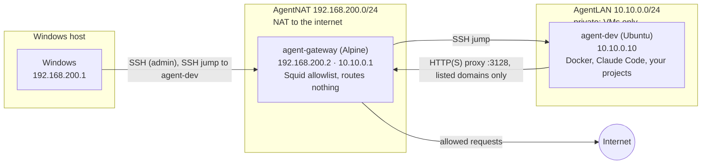

# Agent workstation: setup guide

Agents work in an isolated Linux VM that can only reach an allowlist of sites, and your Windows files, browser sessions and credentials stay out of reach. What it does and doesn't protect against: [threat-model.md](threat-model.md).

| Section | When | Time |
|---|---|---|
| [1. Set up the workstation](#1-set-up-the-workstation-once-per-pc) | Once per PC | about 2 hours |
| [2. Start a new project](#2-start-a-new-project) | Each new project | about 10 minutes |
| [3. Bring in an existing project](#3-bring-in-an-existing-project) | Each repo you already have | about 10 minutes |
| [4. Remove a project](#4-remove-a-project) | When a project ends | a few minutes |

Sections 2–4 reuse the gateway, the dev VM and the GitHub token from section 1.



- **agent-gateway:** a tiny Alpine VM (512 MB). The dev VM's only way out is its Squid proxy, which allows only the domains in [gateway/allowlist.txt](gateway/allowlist.txt). It updates and reboots itself weekly.
- **agent-dev:** Ubuntu Server. Agents have sudo and Docker here; that's safe because nothing in this VM can change the gateway.
- **You** reach the gateway by SSH from Windows, and the dev VM through the gateway (VS Code Remote-SSH).

## 1. Set up the workstation (once per PC)

**Needs:** Windows 11 Pro, Enterprise or Education (Hyper-V); 16 GB RAM or more; about 220 GB free disk; virtualization on in the BIOS; Claude Code on Windows for step 1.

**Where the VMs live:** any folder on a local, fixed NTFS or ReFS drive, not just `C:`. A folder inside your usual development area works. Avoid a folder that's synced (OneDrive, Dropbox), inside a git repo (including this one), on a USB or network drive, or compressed. Step 1 asks for it; the manual path sets it in [windows/hyperv-manual.md](windows/hyperv-manual.md).

**Steps:**

1. **Prepare (agent).** In this repo on Windows, ask Claude: *"Follow setup/windows/AGENT_PREPARE.md"*. It checks your PC, sizes the VMs, downloads and verifies the ISOs, and gives you the command for step 3. If it says Hyper-V is off, enable it as it says and reboot.

2. **SSH key** (PowerShell, in this repo's folder):
   ```powershell
   ssh-keygen -t ed25519 -f $HOME\.ssh\agent_vms -C agent-vms
   Copy-Item $HOME\.ssh\agent_vms.pub setup\gateway\authorized_keys
   Copy-Item $HOME\.ssh\agent_vms.pub setup\devvm\authorized_keys
   Get-Content setup\windows\ssh-config.example | Add-Content $HOME\.ssh\config
   ```
   A passphrase is optional: the key only opens these two VMs. The copies are git-ignored.

3. **Create the VMs:** run the command from step 1 in an **admin** PowerShell. Or click through [windows/hyperv-manual.md](windows/hyperv-manual.md).

4. **Install the gateway OS** (about 10 minutes). Admin PowerShell: `Start-VM agent-gateway; vmconnect.exe localhost agent-gateway`. Log in as `root` (no password), run `ip link` and note which adapter has MAC `00:15:5d:0a:00:01`. Then run `setup-alpine` and answer:

   | Question | Answer |
   |---|---|
   | Keyboard, hostname | yours, `agent-gateway` |
   | Interface to initialize | the one with MAC `...:00:01` |
   | Its IP / netmask / gateway | `192.168.200.2` / `255.255.255.0` / `192.168.200.1` |
   | Next interface | `done`; manual network configuration: `no` |
   | DNS domain / nameserver | blank / `1.1.1.1` |
   | Root password | a strong one (you'll only need it until step 5, then at the console) |
   | Timezone, proxy, NTP | yours, `none`, `chrony` |
   | Mirror | `f` (fastest) |
   | Set up a user | `no` |
   | SSH server / root login / root key | `openssh` / `yes` / `none` (step 5 turns off password login) |
   | Disk / how / erase | `sda` / `sys` / `y` |

   Then `reboot`. Leave the console open: the gateway boots from its disk.

5. **Configure the gateway** (PowerShell, this repo's folder; enter the root password when asked):
   ```powershell
   scp -r setup\gateway root@192.168.200.2:/root/
   ssh root@192.168.200.2 sh /root/gateway/setup-gateway.sh
   ssh agent-gateway denied
   ```
   The last command should run without asking for a password (it prints nothing yet).

6. **Install Ubuntu on the dev VM** (about 15 minutes). Admin PowerShell: `Start-VM agent-dev; vmconnect.exe localhost agent-dev`. Answer:

   | Screen | Answer |
   |---|---|
   | Installer update | **Continue without updating** |
   | Type of install | Ubuntu Server |
   | Network | edit the adapter > IPv4 **Manual**: subnet `10.10.0.0/24`, address `10.10.0.10`, gateway, name servers and search domains **blank** |
   | Proxy | `http://10.10.0.1:3128` |
   | Mirror | the default; its check should pass (through the gateway) |
   | Storage | use the entire disk; **untick** "Set up this disk as an LVM group" |
   | Profile | your name, server `agent-dev`, username **`dev`**, a password |
   | Ubuntu Pro | skip |
   | SSH | **Install OpenSSH server**, allow password authentication (step 7 turns it off), no key import |
   | Snaps | none |

   Reboot when it's done. If the installer starts again, turn the VM off and on.

7. **Bootstrap the dev VM** (PowerShell, this repo's folder; enter the `dev` password when asked):
   ```powershell
   scp -r setup\devvm agent-dev:
   ssh -t agent-dev sudo bash devvm/bootstrap.sh
   ```
   Every network check should say `ok`. Then check `ssh agent-dev` connects **without** a password before closing anything; if it doesn't, the VM console still works.

8. **GitHub access for the VM.**
   - GitHub > Settings > Developer settings > **Fine-grained tokens** > Generate:
     - Name `agent-dev VM`, expiry 90 days (put a reminder in your calendar).
     - Repository access: **Only select repositories**: `dev-template`, plus each project as you create it.
     - Permissions: Contents **read and write**, Pull requests **read**, Actions **read**.
   - In the VM (`ssh agent-dev`):
     ```bash
     gh auth login          # GitHub.com > HTTPS > Paste an authentication token
     gh auth setup-git
     gh repo clone <your-account>/dev-template ~/dev-template
     ```
   This token is the most valuable thing in the VM. Keep it to the repos it needs.

9. **Log in to Claude:** in the VM, `cd ~/dev-template && claude`. Open the login link in your Windows browser and paste the code back.

10. **Finish the VM (agent).** In that Claude session: *"Follow setup/devvm/AGENT_SETUP.md"*. It asks two questions, installs Docker and Claude's user settings, and checks the network.

11. **VS Code:** follow [windows/vscode-settings.md](windows/vscode-settings.md), then connect to `agent-dev`.

12. **Checkpoint** (admin PowerShell): `Checkpoint-VM -Name agent-gateway, agent-dev -SnapshotName clean`. A clean state to go back to.

Next: [start a new project](#2-start-a-new-project) or [bring in an existing one](#3-bring-in-an-existing-project).

## 2. Start a new project

1. **Create it (agent):** in the VM, `cd ~ && claude`, then *"Follow ~/dev-template/AGENT_NEW_PROJECT.md"*. It asks for a name, description and stack, creates `~/projects/<name>` from the template, and makes the first commit.
2. **Connect it to GitHub:** follow the `next-steps/01-github-repo.md` it creates: an empty private repo, added to the `agent-dev VM` token, then the first push.
3. **Open it:** VS Code > Remote-SSH > `agent-dev` > open `~/projects/<name>`.
4. **As it grows:** put development-only keys in `.env` (agents add placeholders to `env.example`), and allow the domains its services need ([Day to day](#day-to-day)).

## 3. Bring in an existing project

1. **Token:** GitHub > Settings > Developer settings > Fine-grained tokens > `agent-dev VM` > Repository access: add the repo.
2. **Clone** (in the VM): `gh repo clone <account>/<repo> ~/projects/<repo>`.
3. **Secrets:** create its `.env` with **development-only** keys with low spending limits ([threat-model.md](threat-model.md)).
4. **Domains:** run its setup and tests once, then `ssh agent-gateway denied` from Windows shows what was refused; allow what it needs.
5. **Agent rules (optional):** if it didn't start from this template, in the project ask Claude: *"Copy `.claude/rules/`, `.claude/hooks/` and `.claude/settings.json` from ~/dev-template/project-template/ into this project, merging with what's here, and fill in project.md"*. Review the diff before committing.

## 4. Remove a project

1. **Keep what matters:** in `~/projects/<name>`, `git status` and `git log --branches --not --remotes` show nothing unpushed. Copy out anything in `next-steps/` or `ideas/` you still want (they're not in git).
2. **Containers and data:** `docker compose down -v --rmi local`. This deletes its volumes, so its local databases too.
3. **Files:** `rm -rf ~/projects/<name>`.
4. **Access:** remove the repo from the `agent-dev VM` token, and revoke the development keys that were in its `.env`.
5. **Domains (optional):** remove ones only it needed: `ssh agent-gateway remove <domain>`. If a domain is also in [gateway/allowlist.txt](gateway/allowlist.txt), delete it there too, or re-running `setup-gateway.sh` adds it back.
6. **Disk space (optional):** `docker system prune` in the VM. The VM's disk file on Windows doesn't shrink by itself.

## Day to day

- **A site is blocked:** from Windows, `ssh agent-gateway denied` lists recent refusals; `ssh agent-gateway allow <domain>` adds one (`.domain.com` for its subdomains too), and `ssh agent-gateway remove <domain>` takes one off. If every setup will need it, add it to [gateway/allowlist.txt](gateway/allowlist.txt) as well.
- **Local AI models (optional):** run Ollama on Windows and let projects use it instead of paid APIs: [windows/ollama.md](windows/ollama.md).
- **Monthly:** in the VM, ask Claude: *"Follow ~/dev-template/setup/maintenance/AGENT_MONTHLY.md"*.
- **Something seems off:** go back to the checkpoint, or rebuild: [maintenance/rebuild.md](maintenance/rebuild.md).

## Troubleshooting

- **Ubuntu's mirror check fails, or `bootstrap.sh` can't reach the Anthropic API:** is the gateway running? `ssh agent-gateway rc-service squid status`. Look for refused names with `ssh agent-gateway denied`.
- **`ssh agent-dev` fails:** the gateway must be running. `ssh -v agent-dev` shows which hop fails. `ssh agent-jump` on its own failing is normal: that account has no shell.
- **"Host key changed" after a rebuild:** `ssh-keygen -R 192.168.200.2` or `ssh-keygen -R 10.10.0.10`.
- **The subnets clash with your network:** see the repo's `CLAUDE.md` > Fixed addresses for every file to change.
