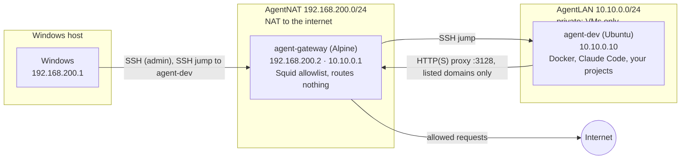

# Agent workstation: setup guide

Agents work in an isolated Linux VM that can only reach an allowlist of sites, and your Windows files, browser sessions and credentials stay out of reach. What it does and doesn't protect against: [threat-model.md](threat-model.md).

| Section | When | Time |
|---|---|---|
| [1. Set up the workstation](#1-set-up-the-workstation-once-per-pc) | Once per PC | about 2 hours |
| [2. Start a new project](#2-start-a-new-project) | Each new project | about 10 minutes |
| [3. Bring in an existing project](#3-bring-in-an-existing-project) | Each repo you already have | about 10 minutes |
| [4. Remove a project](#4-remove-a-project) | When a project ends | a few minutes |

Sections 2–4 reuse the gateway, the dev VM and the GitHub token from section 1.



- **agent-gateway:** a tiny Alpine VM (512 MB). The dev VM's only way out is its Squid proxy, which allows only the domains in [gateway/allowlist.txt](gateway/allowlist.txt). It updates and reboots itself weekly.
- **agent-dev:** Ubuntu Server. Agents have sudo and Docker here; that's safe because nothing in this VM can change the gateway.
- **You** reach the gateway by SSH from Windows, and the dev VM through the gateway (VS Code Remote-SSH).

## 1. Set up the workstation (once per PC)

**Needs:** Windows 11 Pro, Enterprise or Education (Hyper-V); 16 GB RAM or more; about 220 GB free disk; virtualization on in the BIOS; Claude Code on Windows for step 1.

**Where the VMs live:** any folder on a local, fixed NTFS or ReFS drive, not just `C:`. A folder inside your usual development area works. Avoid a folder that's synced (OneDrive, Dropbox), inside a git repo (including this one), on a USB or network drive, or compressed. Step 1 asks for it; the manual path sets it in [windows/hyperv-manual.md](windows/hyperv-manual.md).

**Steps:**

1. **Prepare (agent).** In this repo on Windows, start `claude` and run `/prepare-windows`. It checks your PC, sizes the VMs, and downloads and verifies the ISOs. If it says Hyper-V is off, enable it as it says, reboot and run it again. It ends with your next steps, filled in for your PC: steps 2 and 3 below (the SSH key, then creating the VMs), then on to step 4.

2. **SSH key** (PowerShell, in this repo's folder):
   ```powershell
   ssh-keygen -t ed25519 -f $HOME\.ssh\agent_vms -C agent-vms
   Copy-Item $HOME\.ssh\agent_vms.pub setup\gateway\authorized_keys
   Copy-Item $HOME\.ssh\agent_vms.pub setup\devvm\authorized_keys
   # At the top of your SSH config: ssh uses the first value it finds, so these must come
   # before any `Host *` block (one with ForwardAgent yes would otherwise lend your keys to the VM).
   $cfg = "$HOME\.ssh\config"
   $old = if (Test-Path $cfg) { [IO.File]::ReadAllText($cfg) } else { '' }
   if ($old -notmatch '(?m)^Host agent-gateway\b') {
       [IO.File]::WriteAllText($cfg, [IO.File]::ReadAllText("$PWD\setup\windows\ssh-config.example") + "`n" + $old)
   }
   ```
   A passphrase is optional: the key only opens these two VMs. The copies are git-ignored.

3. **Create the VMs:** run the `create-vms.ps1` command `/prepare-windows` gave you, in an **admin** PowerShell from this repo's folder. Or click through [windows/hyperv-manual.md](windows/hyperv-manual.md).

4. **Install the gateway OS** (about 10 minutes). In an **admin** PowerShell, start the VM and open its console window:
   ```powershell
   Start-VM agent-gateway
   vmconnect.exe localhost agent-gateway
   ```
   In the console, log in as `root` (no password), run `ip link` and note which adapter has MAC `00:15:5d:0a:00:01`. Then run `setup-alpine` and answer:

   | Question | Answer |
   |---|---|
   | Keyboard layout | yours |
   | Hostname | `agent-gateway` |
   | Interface to initialize | the one with MAC `...:00:01` |
   | Its IP / netmask / gateway | `192.168.200.2` / `255.255.255.0` / `192.168.200.1` |
   | IPv6 for that interface | `none` (the gateway turns IPv6 off in step 5) |
   | Next interface to initialize | `done` |
   | Do any manual network configuration? | `no` (the DNS questions come next either way) |
   | DNS domain / nameserver | blank / `1.1.1.1` |
   | Root password | a strong one, saved in your password manager: after step 5 it's only for logging in at the VM console, if SSH ever stops working |
   | Timezone, proxy, NTP | yours, `none`, `chrony` |
   | Mirror | `f` (fastest) |
   | Set up a user | `no` |
   | SSH server / root login / root key | `openssh` / `yes` / `none` (step 5 turns off password login) |
   | Disk / how / erase | `sda` / `sys` / `y` |

   When `setup-alpine` finishes, type `reboot` and press Enter to restart the VM. Leave the console window open: the gateway now starts from its own disk, and you log in there as `root` with the password you just set.

5. **Configure the gateway** (PowerShell, this repo's folder; enter the root password when asked):
   ```powershell
   scp -r setup\gateway root@192.168.200.2:/root/
   ssh root@192.168.200.2 sh /root/gateway/setup-gateway.sh
   ssh agent-gateway denied
   ```
   The last command should run without asking for a password (it prints nothing yet). The script turns password login off, so to run it again later (e.g. after a pull, or if this run was interrupted), use `agent-gateway` in place of `root@192.168.200.2` in the first two commands: that name logs in with your key.

6. **Install Ubuntu on the dev VM** (about 15 minutes). In an **admin** PowerShell, start the VM and open its console window:
   ```powershell
   Start-VM agent-dev
   vmconnect.exe localhost agent-dev
   ```
   In the console, answer:

   | Screen | Answer |
   |---|---|
   | Installer update | **Continue without updating** |
   | Type of install | Ubuntu Server |
   | Network | edit `eth0` > Edit IPv4 > **Manual**: subnet `10.10.0.0/24`, address `10.10.0.10`, gateway, name servers and search domains **blank** > Save. `eth0` then shows `static 10.10.0.10/24`; choose **Continue without network** (with no gateway the installer counts it as offline, but keeps the address) |
   | Proxy | `http://10.10.0.1:3128` |
   | Mirror | the default. Being "offline", the installer may skip its check or say it can't connect: carry on (`bootstrap.sh` updates packages later, through the gateway) |
   | Storage | use the entire disk; **untick** "Set up this disk as an LVM group" |
   | Confirm destructive action | **Continue**: it erases only the VM's own new, empty virtual disk |
   | Profile | your name: anything, e.g. `Dev` (it's only a label on the account, readable by everything in the VM); server `agent-dev`; username **`dev`**; a strong password, saved in your password manager: after step 7 it's only for logging in at the VM console, if SSH ever stops working (sudo won't ask for it) |
   | Ubuntu Pro | skip |
   | SSH | **Install OpenSSH server**, allow password authentication (step 7 turns it off), no key import |
   | Snaps | none |

   When it's done, choose **Reboot Now**. If it says to remove the installation medium, just press Enter: the VM boots from its disk first.

   If the installer starts again anyway, eject the ISO and restart the VM (admin PowerShell; the console window reconnects by itself):
   ```powershell
   Get-VMDvdDrive -VMName agent-dev | Set-VMDvdDrive -Path $null
   Stop-VM agent-dev -TurnOff
   Start-VM agent-dev
   ```
   The installed system then starts to an `agent-dev login:` prompt.

7. **Bootstrap the dev VM** (about 10 minutes; PowerShell, this repo's folder; enter the `dev` password when asked, including once for `sudo`):
   ```powershell
   scp -r setup\devvm agent-dev:
   ssh -t agent-dev sudo bash devvm/bootstrap.sh
   ```
   What it does, in order (each part prints a `==` heading):
   - **SSH:** your key only; password login off.
   - **sudo** without a password for `dev` (agents can't type one).
   - **Proxy:** points the system, apt and downloads at the gateway.
   - **Packages:** updates everything Ubuntu installed (the longest part), then installs git, curl, jq, Node.js, the GitHub CLI and Claude Code.
   - **Network checks:** each line should say `ok`.

   Then check `ssh agent-dev` connects **without** a password before closing anything; if it doesn't, the VM console still works.

8. **GitHub access for the VM.**
   - GitHub > Settings > Developer settings > **Fine-grained tokens** > Generate:
     - Name `agent-dev VM`, expiry 90 days (put a reminder in your calendar).
     - Repository access: **Only select repositories**: each project as you create it. **Not `dev-template`**: its scripts run as root on the gateway and as admin on Windows, so nothing in the VM may write to it.
     - Permissions: Contents **read and write**, Pull requests **read**, Actions **read**. Not Workflows.
   - If `dev-template` is private, generate a second token: name `agent-dev VM template (read-only)`, same expiry, only `dev-template`, Contents **read** only.
   - In the VM (`ssh agent-dev`):
     ```bash
     gh auth login          # GitHub.com > HTTPS > Paste the agent-dev VM token
     gh auth setup-git
     # dev-template, read-only. Public repo: just  git clone https://github.com/<your-account>/dev-template.git ~/dev-template
     read -rsp 'Read-only token: ' T; echo
     install -d -m 700 ~/.config/dev-template
     printf 'https://x-access-token:%s@github.com\n' "$T" > ~/.config/dev-template/.git-credentials; unset T
     chmod 600 ~/.config/dev-template/.git-credentials
     H="store --file=$HOME/.config/dev-template/.git-credentials"
     git -c credential.helper= -c credential.helper="$H" clone https://github.com/<your-account>/dev-template.git ~/dev-template
     git -C ~/dev-template config credential.helper ''          # drop gh's helper for this repo...
     git -C ~/dev-template config --add credential.helper "$H"  # ...and use the read-only token
     ```
   - **Protect default branches** where your plan allows (rulesets need a public repo, or GitHub Pro/Team for private ones), with the settings in [github-repo-settings.md](github-repo-settings.md). Agents may push feature branches; this stops anything pushing straight to `main`. `/new-project` and `/import-project` give you the checklist for each project.
   - After pulling `dev-template` on Windows, read `git diff` of `setup/` before re-running any of its scripts there or on the gateway.

   The `agent-dev VM` token is the most valuable thing in the VM. Keep it to the repos it needs.

9. **Log in to Claude:** in the VM, `cd ~/dev-template && claude`. Open the login link in your Windows browser and paste the code back.

10. **Finish the VM (agent).** In that Claude session, run `/finish-vm-setup`. It asks two questions, installs Docker and Claude's user settings and skills, and checks the network.

11. **VS Code:** follow [windows/vscode-settings.md](windows/vscode-settings.md), then connect to `agent-dev`.

12. **Checkpoint** (admin PowerShell): `Checkpoint-VM -Name agent-gateway, agent-dev -SnapshotName clean`. A clean state to go back to.

Next: [start a new project](#2-start-a-new-project) or [bring in an existing one](#3-bring-in-an-existing-project).

## 2. Start a new project

1. **Create it (agent):** in the VM, `cd ~ && claude`, then `/new-project`. It asks for a name, description and stack, creates `~/projects/<name>` from the template, and makes the first commit.
2. **Connect it to GitHub:** follow the `next-steps/01-github-repo.md` it creates: an empty private repo, added to the `agent-dev VM` token, then the first push.
3. **Open it:** VS Code > Remote-SSH > `agent-dev` > open `~/projects/<name>`.
4. **As it grows:** put development-only keys in `.env` (agents add placeholders to `env.example`), and allow the domains its services need ([Day to day](#day-to-day)).

## 3. Bring in an existing project

1. **Token:** GitHub > Settings > Developer settings > Fine-grained tokens > `agent-dev VM` > Repository access: add the repo.
2. **Bring it in (agent):** in the VM, `cd ~ && claude`, then `/import-project`. It clones the repo into `~/projects/`, can add this template's agent rules on a branch, runs the project once to find refused domains, and lists what's left for you.
3. **Secrets:** create its `.env` with **development-only** keys with low spending limits ([threat-model.md](threat-model.md)).
4. **Domains:** `ssh agent-gateway denied` from Windows shows what was refused; allow what it needs.

## 4. Remove a project

1. **Remove it (agent):** in the VM, `cd ~ && claude`, then `/remove-project`. It checks for anything unpushed (including `next-steps/` and `ideas/`, which aren't in git), asks before deleting, then removes the project's containers, volumes (its local databases) and folder.
2. **Access:** remove the repo from the `agent-dev VM` token, and revoke the development keys that were in its `.env`.
3. **Domains (optional):** remove ones only it needed: `ssh agent-gateway remove <domain>`. If a domain is also in [gateway/allowlist.txt](gateway/allowlist.txt), delete it there too, or re-running `setup-gateway.sh` adds it back.

## Day to day

- **A site is blocked:** from Windows, `ssh agent-gateway denied` lists recent refusals; `ssh agent-gateway allow <domain>` adds one (`.domain.com` for its subdomains too), and `ssh agent-gateway remove <domain>` takes one off. If every setup will need it, add it to [gateway/allowlist.txt](gateway/allowlist.txt) as well.
- **Openings to your side of the gateway (optional):** `ssh agent-gateway access` lists them; each is one host, off until you add it.
  - Local AI models: run Ollama on Windows and let projects use it instead of paid APIs: [windows/ollama.md](windows/ollama.md).
  - A device on your network (e.g. a Raspberry Pi) that a project's agent may SSH into: run `/remote-device` in that project. While its access is on, the device is a way around the gateway ([threat-model.md](threat-model.md)): keep sessions short.
- **Monthly:** in the VM, `git -C ~/dev-template pull`, then in Claude run `/monthly-upkeep`. It also refreshes Claude's user config and skills, and lists projects behind the template. (A VM set up before the skills existed needs them once: `mkdir -p ~/.claude/skills && cp -r ~/dev-template/setup/devvm/claude-user/skills/* ~/.claude/skills/`.)
- **Every few months:** `ssh agent-gateway release-upgrade` says whether Alpine has a newer release (the weekly updates stay within the installed one, which stops getting fixes after about two years); `release-upgrade apply` moves to it.
- **Template changed:** in a project, run `/sync-template` to bring its rules, skills and guardrails up to date (on a branch, keeping the project's own edits).
- **Disk space on Windows:** the VM's disk file grows but never shrinks by itself: [maintenance/disk-space.md](maintenance/disk-space.md).
- **Something seems off:** go back to the checkpoint, or rebuild: [maintenance/rebuild.md](maintenance/rebuild.md).

## Troubleshooting

- **Ubuntu's mirror check fails, or `bootstrap.sh` can't reach the Anthropic API:** is the gateway running? `ssh agent-gateway rc-service squid status`. Look for refused names with `ssh agent-gateway denied`.
- **`ssh agent-dev` fails:** the gateway must be running. `ssh -v agent-dev` shows which hop fails. `ssh agent-jump` on its own failing is normal: that account has no shell.
- **"Host key changed" after a rebuild:** `ssh-keygen -R 192.168.200.2` or `ssh-keygen -R 10.10.0.10`.
- **The subnets clash with your network:** see the repo's `CLAUDE.md` > Fixed addresses for every file to change.
