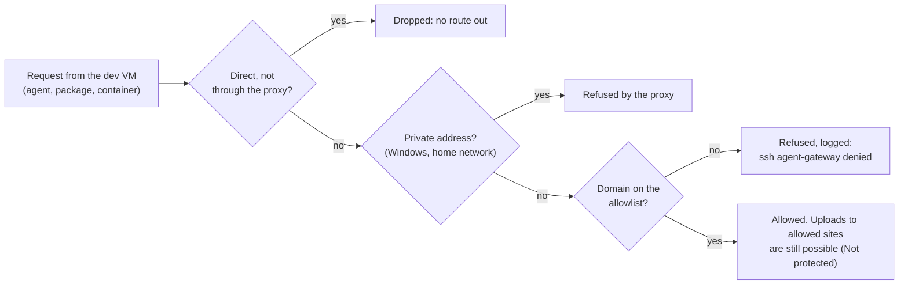

# What the agent workstation protects against

**The worry:** an agent, or a package or script it installs, reads instructions planted on a web page, in a README or in an install script, and sends your information to someone else's server.

How a request from the dev VM gets out, or doesn't:

## Protected

- **Your Windows life:** files, browser sessions, saved passwords, SSH keys, cloud credentials. They aren't in the VM, and VS Code is set up not to lend them across (`windows/vscode-settings.md`).
- **Sending data to arbitrary servers:** the dev VM has no route to the internet. Its only way out is the gateway's proxy, which allows only listed domains, and nothing in the dev VM can change that, even as root.
- **Your home network and the Windows host:** the dev VM sits on a private switch; the proxy refuses private addresses.
- **Lasting damage:** checkpoints, and both VMs rebuild from this repo's scripts.

## Not protected

- **What's inside the VM:** your code, the GitHub token, the Claude login, project `.env` values. Some allowed sites accept uploads (GitHub, npm, PyPI, Google Cloud Storage), so a planted instruction that includes an attacker's own credentials could still carry data out through them. Keep in the VM only what you could afford to lose:
  - a fine-grained GitHub token, limited to the repos it needs and set to expire;
  - development-only API keys with low spending limits;
  - no cloud credentials: deploy from CI (e.g. GitHub Actions with OIDC), never from the VM.
- **Changes pushed to your repos:** the token can write to its repos. Review pull requests before merging, and keep deploys manual.
- **The VS Code bridge:** VS Code can ask to open links from the VM in your Windows browser, and a link can carry data. Only open ones you expect, or use a plain SSH terminal.
- **Hypervisor escapes:** rare, and patched through Windows Update. Keep Windows updated.

## Guardrails, not the boundary

Claude's deny rules, the secrets hooks and the instruction files stop mistakes and catch most injected instructions, but an agent with root in the VM could remove them. The boundary is the VM plus the gateway.

## Why a gateway VM

Alternatives considered:
- **A firewall inside the dev VM, with a no-sudo agent user and rootless Docker.** One VM, but an agent with sudo or ordinary Docker access is effectively root and could turn the firewall off. That means no sudo for agents, and rootless Docker's quirks.
- **Devcontainers on Windows.** Mounting the Docker socket hands the agent the host, and the egress firewall lives inside the container it protects.
- **Cloud sandboxes.** Nothing personal on the machine, but they cost money past free tiers and are awkward for Docker-heavy work.

The gateway costs one 512 MB VM that maintains itself, and in return agents can have full sudo and normal Docker.
