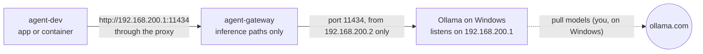

# Local models: Ollama on Windows (optional)

Lets projects in the dev VM use models running on Windows (with its GPU) instead of paid APIs. Off until you turn it on. Works for new and existing workstations and every project; no project changes beyond pointing its code at the address below.



**What the VM can do:** chat, generate, embeddings, list and show models (Ollama's own API and its OpenAI-compatible `/v1/` API). **What it can't:** pull, push, create, copy or delete models. Those reach registries from Windows, outside the allowlist, so the gateway refuses them.

## Turn it on

1. **Gateway command:** from Windows, `ssh agent-gateway ollama status`. If it says `command not found`, the gateway is older than this guide: re-run [../README.md](../README.md) step 5 (safe to re-run; your allowlist is kept).
2. **Install Ollama** for Windows from ollama.com, or update it. If Windows Firewall asks about Ollama (it may after step 4), click **Cancel**: step 5 adds a narrower rule.
3. **Local models only:** don't sign in to an ollama.com account in this install, and don't use models whose names end in `-cloud`. Cloud models send prompts to ollama.com, which would carry data out of the VM past the allowlist.
4. **Listen on the VM network only** (PowerShell):
   ```powershell
   [Environment]::SetEnvironmentVariable('OLLAMA_HOST', '192.168.200.1:11434', 'User')
   ```
   Quit Ollama from the system tray and start it again. Never use `0.0.0.0`: that exposes Ollama to your home network. Windows apps and the `ollama` command now use this address too (they read the same variable).
5. **Firewall** (admin PowerShell): allow the gateway, and only the gateway.
   ```powershell
   Get-NetFirewallRule -DisplayName '*ollama*' -ErrorAction SilentlyContinue | Remove-NetFirewallRule   # broad rules from a firewall prompt
   New-NetFirewallRule -DisplayName 'Ollama from agent-gateway' -Direction Inbound -Action Allow -Protocol TCP `
       -LocalPort 11434 -LocalAddress 192.168.200.1 -RemoteAddress 192.168.200.2 -InterfaceAlias 'vEthernet (AgentNAT)'
   ```
6. **Models:** pull the ones you want on Windows, e.g. `ollama pull llama3.2`.
7. **Turn on the gateway rule:** `ssh agent-gateway ollama on`.
8. **Tell the VM's agents** (dev VMs set up before this guide): in the VM, `git -C ~/dev-template pull`, then run `/monthly-upkeep`; it updates `~/.claude/CLAUDE.md`.
9. **Check** in the VM (`ssh agent-dev`):
   ```bash
   curl -s http://192.168.200.1:11434/api/tags                       # lists your models
   curl -s -o /dev/null -w '%{http_code}\n' -X POST \
        http://192.168.200.1:11434/api/pull -d '{"model":"x"}'       # 403: refused by the gateway
   ```

## Using it in a project

- Put the address in the project's settings, e.g. `OLLAMA_BASE_URL=http://192.168.200.1:11434` in `env.example` and `.env`. For OpenAI-compatible clients: base URL `http://192.168.200.1:11434/v1`, any non-empty API key.
- Requests must go through the proxy: don't add `192.168.200.1` to a container's `NO_PROXY`.
- Keep the provider behind an interface (engineering-style.md > Design) so the project can switch to a paid API later.
- Treat model output as untrusted content (security.md).

## Upkeep and turning it off

- Keep Ollama updated on Windows: it's reachable from the VM, if only through the gateway's filter.
- If Ollama starts before the AgentNAT adapter is up (after a Windows restart) and the VM can't reach it, quit and start Ollama again.
- **Off:** `ssh agent-gateway ollama off`. To remove it entirely, also `Remove-NetFirewallRule -DisplayName 'Ollama from agent-gateway'` (admin) and `[Environment]::SetEnvironmentVariable('OLLAMA_HOST', $null, 'User')`.
